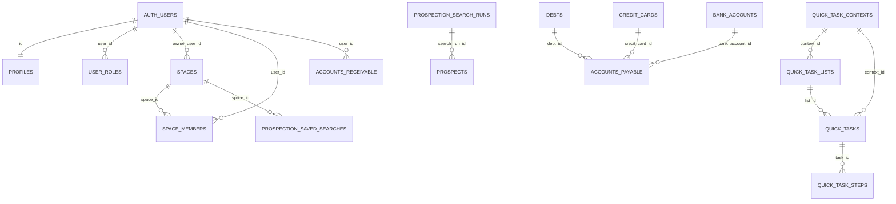

# DOCUMENTAÇÃO TÉCNICA E FUNCIONAL — SuperFlow / FlowBoard

> PARTE 1 de 4 — Seções 1, 2, 3 e 5 (Visão geral, Stack, Rotas/Menus, Modelo de dados) + 10 (Resumo final).
> PARTE 2 (`DOCUMENTACAO_SUPERFLOW_PARTE2.md`): Seção 4 — telas gerais, financeiro, tarefas, configurações.
> PARTE 3 (`DOCUMENTACAO_SUPERFLOW_PARTE3.md`): Seção 4 (cont.) e 6 — CRM Agência/Marketing, Prospecção/Apify, fluxos ponta a ponta.
> PARTE 4 (`DOCUMENTACAO_SUPERFLOW_PARTE4.md`): Seção 4 (cont.), 7, 8 e 9 — Imobiliário e demais templates, integrações, componentes, design, pontos fracos.
>
> Documento gerado por leitura estática do código (nenhum código foi alterado). Referências no formato `arquivo:linha`.

---

## 1. VISÃO GERAL

### 1.1 O que o sistema faz
SuperFlow (marca interna "FlowBoard") é um "sistema operacional" de produtividade + CRMs verticais. Um mesmo usuário opera:
- um **espaço Pessoal** ("Meu FlowBoard") para tarefas, projetos, fluxos de trabalho, metas, funis visuais e finanças pessoais;
- **espaços Profissionais** (empresa/cliente/time) com um CRM vertical: Agência/Marketing, Imobiliário (corretor) e — com código existente mas rotas desativadas — Prestador de serviço, Loja, Clínica, Escola e Advocacia.

Público: profissionais autônomos, agências de marketing pequenas e corretores de imóveis (o super-admin é dono da agência "RG Marketing").

### 1.2 Objetivo de cada espaço
| Espaço | Objetivo | Estado |
|---|---|---|
| Pessoal (`id === "personal"`) | Produtividade pessoal: Dashboard, Tasks, Hoje, Semana, Projetos, Fluxos, Funis, Metas, Financeiro, Planilha | Funcional (dados locais, exceto Tasks e parte do financeiro na nuvem) |
| Agência/Marketing (`type: agencia`) | Comercial (pipeline, clientes, propostas, conversões, contatos, WhatsApp simulado), Marketing, Prospecção (Apify), Dashboard de Campanhas, Entregas, Scripts | Funcional local + Prospecção na nuvem |
| Imobiliário (`type: imobiliaria`, CRM `corretor`) | Comercial imobiliário, Imóveis, Visitas, Propostas/Comissões, Marketing, Campanhas, Relatórios do corretor | Funcional local |
| Prestador / Loja / Clínica / Escola / Advocacia | CRMs setoriais completos (dashboards, cadastros, agenda, pagamentos) | Código existe; rotas `/prestador/*` etc. redirecionam para `/crm` (desativadas) |
| Outro (`type: outro`) | Espaço profissional genérico (modo produtividade) | Funcional |

### 1.3 Lógica de Espaços
- **Modelo** (`src/store/useSpacesStore.ts`): `kind` (pessoal | team | projeto | empresa | cliente), `type` (imobiliaria, agencia, prestador_servico, loja, clinica, escola, advocacia, pessoal, outro), `status` (ativo | arquivado), `lifecycleStatus` (active, trial, suspended, canceled, pending_setup), `plan` (gratuito, teste, basico, profissional, enterprise, personalizado), `enabledCrms`, `activeCrm` (singular), `members`, `invites`, `activity`, vínculos com projetos/fluxos/metas.
- **Persistência**: localStorage, chave `flowboard-spaces-v1`. Existe também a tabela `spaces`/`space_members` no banco, mas a UI principal de espaços opera sobre o store local.
- **Classificação**: `getSpaceProfile(space)` em `src/lib/spaceProfile.ts` — `id === "personal"` → pessoal; demais → profissional, subtipo por `type`. Mapeamento de modo recomendado: agencia→agencia, imobiliaria→corretor, prestador_servico→prestador, loja, clinica, escola, advocacia, outro→produtividade.
- **Divergência conhecida**: `AppSidebarStable` classifica pessoal por `type === "pessoal"`, não por ID.
- **Criação**: `createSpace()` gera id+slug, status ativo, plano gratuito, dono `"me"`, membro inicial local. A UI de criação do sidebar oferece só Pessoal/Agência/Imobiliária (Teams oferece todos os tipos). Criar não seleciona automaticamente.
- **Troca**: `setCurrentSpace(id)` — sem validação de associação. O hook `useSpaceModeSync` (montado no AppLayout) aplica o modo de uso recomendado ao trocar de espaço, de forma idempotente via `_lastSyncedSpaceId`, respeitando `mode === "personalizado"`.
- **Seed**: novos usuários recebem apenas "Meu FlowBoard". O espaço "RG Marketing" é semeado somente para o super-admin.
- **Isolamento**: `filterBySpace(items, spaceId)` (`src/lib/spaceScope.ts`): no pessoal mostra itens sem `spaceId` ou com `personal`; nos demais só igualdade exata. É filtro de frontend, não segurança. Na nuvem, o isolamento é por RLS (`space_id` + membership).
- **Exclusão**: deve chamar `purgeSpaceData(id)` (`src/lib/spaceCleanup.ts`), que limpa menu, overrides de permissões, demo de campanhas, funis (`_bySpace`), jornada, prospecção, scripts e registros da agência. Não cobre todos os stores (financeiro, imóveis, colaboração ficam).
- **Compartilhado entre espaços**: perfil do usuário, aparência/tema, preferências; o store geral (`useStore`) guarda tudo junto com `spaceId` por item.
- **Membros/convites**: papéis de espaço dono, administrador, gestor, colaborador, visualizador, financeiro, cliente (+editor legado); status ativo/aprovado/convidado/pendente/recusado/bloqueado/removido. Convite gera token local; **não envia e-mail** ("Envio real por e-mail será integrado futuramente"); aceite em `/space-invite/:spaceId/:token` só funciona no mesmo navegador (mock). Teams possui botão "Simular aceite (mock)".

### 1.4 Modos de uso (templates de menu)
`src/store/useUsageModeStore.ts` — 12 modos: produtividade, financeiro, negocios, criador, corretor, agencia, prestador, loja, clinica, escola, advocacia, personalizado. Cada preset define título do dashboard, ordem do menu, rota inicial e pins sugeridos (não é whitelist). Rotas iniciais: produtividade `/dashboard`, financeiro `/planilha-financeira`, negocios `/negocios`, criador `/fluxos`, corretor `/dashboard`. "Restaurar padrão" reaplica o preset; templates nunca são reaplicados automaticamente a cada render.

---

## 2. STACK E ARQUITETURA

### 2.1 Frontend
| Área | Tecnologia |
|---|---|
| Framework | React 18 + Vite 5 + TypeScript 5 |
| UI kit | shadcn/ui (Radix UI: dialog, popover, select, tabs, dropdown, tooltip, accordion, etc.), Tailwind CSS 3 + tailwindcss-animate, lucide-react (ícones), vaul (drawer), sonner (toasts), cmdk |
| Estado | Zustand 5 com `persist` (localStorage) — ~40 stores em `src/store` |
| Dados remotos | @supabase/supabase-js 2, @tanstack/react-query 5 (hooks financeiros) |
| Roteamento | react-router-dom 6 |
| Formulários | react-hook-form + zod (+ muitos formulários com useState) |
| Gráficos | recharts |
| Datas | date-fns 3, react-day-picker |
| Drag & drop | @dnd-kit/core + sortable |
| Diagramas | reactflow 11 (Funis/mapas mentais) |
| Mapas | leaflet + react-leaflet 4.2 (Prospecção), react-simple-maps + d3-geo (Regiões no Dashboard de Campanhas) |
| Outros | embla-carousel, react-resizable-panels, input-otp, next-themes (tema claro/escuro) |
| Testes | vitest + Testing Library |

### 2.2 Estrutura de pastas
| Pasta | Papel |
|---|---|
| `src/pages` | Páginas por rota; subpastas `agencia`, `imobiliario`, `auth`, `auth/cloud`, `clinica`, `advocacia`, `escola`, `loja`, `prestador` |
| `src/components` | Componentes por domínio: `agencia` (incl. `prospeccao`, `pipeline`, `jornada`, `regions`), `agency`, `broker`, `properties`, `visits`, `proposals`, `finance`, `funnels`, `tasks`, `ai`, `metas`, `projetos`, `settings`, `teams`, `collaboration`, `sharing`, `assignments`, `onboarding`, `spaces`, `layout`, `auth`, `crm`, `clinic`, `law`, `school`, `business`, `provider`, `common`, `ui` (shadcn) |
| `src/store` | Stores Zustand (dados locais + estado de UI) |
| `src/hooks` | Hooks Supabase (contas a pagar/receber, bancos, cartões, usuário atual), filtros, sync de modo |
| `src/lib` | Regras puras: permissões, papéis, perfis de espaço, score de prospecção, matching de imóveis, relatórios, classificador de fluxo, helpers anti-loop, adaptadores cloud (`prospectsCloud.ts`, `quickTasksCloud.ts`) |
| `src/data` | Seeds e catálogos (nichos, mercados, estratégias, presets de prospecção, scripts, seed financeiro, mocks de ads) |
| `src/integrations/supabase` | Cliente e tipos gerados (não editar) |
| `supabase/functions` | Edge Functions (Deno) |
| `supabase/migrations` | 14 migrações SQL |

### 2.3 Backend
- **Supabase (Lovable Cloud)**: Postgres + Auth + Edge Functions. Storage não é usado (fotos/arquivos são URLs digitadas).
- **Autenticação**: e-mail/senha (`signInWithPassword`, `signUp`, reset por e-mail para `/auth/reset-password`) e Google OAuth. Novo usuário cai em `profiles` com `status = pending` (trigger `handle_new_user`) e precisa ser aprovado pelo super-admin. Papéis em `user_roles` (`app_role`).
- **Edge Functions** (todas exigem JWT e validam membership do espaço ou super_admin):
  - `apify-ping` — teste de conexão com o token Apify.
  - `apify-start-lead-search` — inicia o Actor `compass/crawler-google-places` de forma assíncrona e grava em `prospection_search_runs`.
  - `apify-lead-search-status` — consulta status do run (RUNNING não é erro).
  - `apify-lead-search-results` — baixa dataset, normaliza, deduplica (Place ID > telefone/site > nome+cidade) e devolve preview; aceita `actorRunId` bruto para recuperar buscas órfãs.
  - `apify-cancel-lead-search` — aborta run.
  - `apify-list-search-runs` — lista histórico/ativas.
- **Cron jobs**: nenhum. O expurgo da lixeira (30 dias) roda no cliente.

### 2.4 Variáveis de ambiente (somente nomes)
Frontend: `VITE_SUPABASE_URL`, `VITE_SUPABASE_PUBLISHABLE_KEY`, `VITE_SUPABASE_PROJECT_ID`, `VITE_ROLES` (flag legada).
Edge Functions: `SUPABASE_URL`, `SUPABASE_ANON_KEY`, `SUPABASE_SERVICE_ROLE_KEY`, `APIFY_API_TOKEN`.

### 2.5 Onde cada dado vive (crítico para a reconstrução)
| Na nuvem (Supabase) | Somente no navegador (localStorage) |
|---|---|
| Perfis, papéis globais, (espaços/membros — tabelas existem) | Espaços e membros usados pela UI (`flowboard-spaces-v1`) |
| Tasks (contextos, listas, tarefas, etapas) | Tarefas de Hoje/Semana, projetos, metas, fluxos, clientes, vendas, ofertas, financeiro simples (`flowboard-ai-v6`) |
| Contas a pagar, contas a receber, dívidas, contas bancárias, cartões | Planilha financeira: entradas, despesas, contas, reservas, metas (`flowboard-finance-v2`) |
| Prospects, execuções de busca, nichos, buscas salvas | Agência (clientes, campanhas, conteúdos, entregas, propostas), marketing, vídeos, scripts, WhatsApp simulado, conversões, contatos, jornada |
| | Funis (`flowboard-funnels-v1`), imóveis (`flowboard-properties-v1`), visitas (`flowboard-visits-v1`), propostas imobiliárias, campanhas gerais, conteúdo geral |
| | CRMs setoriais (`flowboard-clinic-crm-v1`, `-law-`, `-school-`, `-store-`, `flowboard-provider-v1`), atribuições, permissões (`fb-permissions-store`), menu, aparência |

---

## 3. MAPA DE ROTAS E NAVEGAÇÃO

### 3.1 Rotas públicas / autenticação (`src/App.tsx`)
| Rota | Página |
|---|---|
| `/` | RootGate (landing ou redireciona) |
| `/landing`, `/login`, `/cadastro`, `/signup`, `/auth/forgot-password` | Redirecionamentos |
| `/auth/login`, `/auth/cadastro`, `/auth/esqueci-senha`, `/auth/reset-password` | Login, Cadastro, Esqueci senha, Redefinir senha |
| `/auth/conta-pendente`, `/auth/conta-bloqueada`, `/auth/conta-rejeitada`, `/auth/sem-espaco` | Estados de conta |
| `/auth/cloud/login`, `/auth/cloud/cadastro`, `/auth/cloud/callback`, `/auth/cloud/migracao` | Fluxo cloud paralelo (legado de migração) |
| `/space-invite/:spaceId/:token` | Aceite de convite (local) |
| `*` | NotFound |

### 3.2 Rotas autenticadas (AuthGuard + AppLayout)
AuthGuard: sem sessão → login; `pending`/`rejected`/`blocked` → telas de conta; sem espaços (não-admin) → `/auth/sem-espaco`.

| Grupo | Rotas |
|---|---|
| Geral | `/dashboard`, `/tasks`, `/hoje`, `/semana`, `/projetos`, `/fluxos`, `/funis`, `/metas`, `/negocios`, `/clientes`, `/teams` |
| Financeiro | `/financeiro`, `/planilha-financeira` |
| Sistema | `/lixeira`, `/configuracoes`, `/configuracoes/permissoes`, `/perfil`, `/espaco/usuarios`, `/integracoes`, `/agente-chat`, `/admin` |
| CRM Agência | `/agencia/comercial`, `/agencia/pipeline`, `/agencia/clientes`, `/agencia/propostas`, `/agencia/conversoes`, `/agencia/contatos`, `/agencia/whatsapp`, `/agencia/marketing` (= `/marketing`), `/agencia/prospeccao`, `/agencia/dashboard-campanhas` (`/agencia/campanhas` redireciona), `/agencia/conteudo`, `/agencia/entregas`, `/agencia/relatorios`, `/agencia/scripts`, `/agencia/videos` |
| CRM Imobiliário | `/imobiliario/comercial`, `/imoveis`, `/funil-imobiliario`, `/visitas`, `/propostas`, `/campanhas`, `/conteudo`, `/relatorios-corretor` (= `/relatorios`) |
| CRM genérico | `/crm`, `/crm/outros` |
| Desativadas | `/prestador/*`, `/loja/*`, `/clinica/*`, `/escola/*`, `/advocacia/*` → redirecionam para `/crm` |

### 3.3 Menu lateral efetivo (`AppSidebarStable.tsx`)
O componente ativo é `AppSidebarStable` (flag `fullSidebar: true`); `AppSidebar.tsx` é legado. Flags: `protectedRoute`, `crmModuleGuard`, `authPermissionsSync`, `onboarding`, `dragAndDrop`, `contextMenuOnItems`, `modeDropdown`, `fullUserMenu`, `topBar` = **false**; `fullSpaceSwitcher` = true.

| Tipo de espaço | Geral | Financeiro | Sistema | CRM |
|---|---|---|---|---|
| Pessoal | Dashboard, Tasks, Hoje, Semana, Projetos, Fluxos, Funis, Metas, WhatsApp | Financeiro, Planilha Financeira | Lixeira, Configurações | nunca |
| Agência | Tasks, Funis, WhatsApp (+ Integrações por padrão em Geral) | idem | idem | (se `activeCrm = agencia`) Dashboard da Agência, Comercial, Marketing, Prospecção, Dashboard de Campanhas, Entregas, Scripts |
| Imobiliária | Tasks, Funis, WhatsApp | idem | idem | (se `activeCrm = corretor`) Dashboard do Corretor, Comercial, Imóveis, Marketing, Dashboard de Campanhas |
| Prestador/Loja/Clínica/Escola/Advocacia/Outro | Dashboard, Tasks, Funis, WhatsApp | idem | idem | vazio |

Abas consolidadas: "Comercial" da agência = Pipeline, Clientes, Propostas, Conversões, Contatos, WhatsApp. "Comercial" imobiliário = Pipeline, Clientes, Propostas, Visitas, Conversões, Contatos.
Customização por espaço (Configurações › Menu Lateral, com abas por espaço): ocultar itens, mover entre seções, seções customizadas, ordem por seção. Agência e Imobiliária ignoram pins. Mobile: barra inferior configurável (`useMobileNavStore` / `mobileNavTemplates`).

### 3.4 Papéis e permissões
- Globais (`app_role`): super_admin (100), platform_admin (80), business_owner (60), manager (40), collaborator (20), viewer (10). Usuário cloud comum é espelhado localmente como `business_owner`.
- Catálogo granular (`src/lib/permissions.ts`): grupos Dashboard, Tarefas, Clientes, Financeiro, CRM, Usuários, Espaços, Plataforma, Relatórios, Funis. Precedência: super_admin sempre → override → default do papel. Overrides salvos localmente.
- Permissões por rota (`routePermissions.ts`) existem mas estão **desligadas** (`protectedRoute: false`).
- Limite de CRMs por plano: gratuito/teste/básico 1, profissional 3, enterprise/personalizado ilimitado (mas `activeCrm` é singular).

---

## 5. MODELO DE DADOS (Supabase)

> Todas as tabelas têm RLS ativa. `id uuid` default `gen_random_uuid()`, `created_at`/`updated_at timestamptz` default `now()` (trigger `set_updated_at`).

### 5.1 Identidade
**profiles** — `id uuid PK → auth.users`, `email text NN`, `full_name`, `avatar_url`, `status user_status NN (default pending)`. RLS: usuário vê/edita o próprio; super_admin vê/edita todos; INSERT/DELETE negados (criado pelo trigger `handle_new_user`).
**user_roles** — `id`, `user_id → auth.users`, `role app_role NN`. RLS: usuário vê os próprios; super_admin gerencia todos. Função `has_role(_user_id,_role)` (security definer).

### 5.2 Espaços
**spaces** — `id uuid`, `name NN`, `type text NN`, `active_crm text`, `owner_user_id uuid NN → auth.users`. RLS: membros veem; qualquer autenticado cria sendo dono; dono ou super_admin altera/exclui.
**space_members** — `id`, `space_id → spaces`, `user_id → auth.users`, `role space_member_role NN`, `status user_status NN`. RLS: membro vê co-membros; dono/super_admin adiciona/altera; dono, o próprio ou super_admin remove.
Funções: `is_space_member(uuid,uuid)`, `space_role(uuid,uuid)`, `can_access_space(text, created_by)` — aceita `space_id` em texto (UUID ou slug local como `personal`), liberando membro aprovado, criador ou super_admin.

### 5.3 Financeiro (todas com `user_id uuid NN`, `space_id text NN`)
**bank_accounts** — `name NN`, `type bank_account_type NN`, `bank`, `initial_balance numeric NN`, `color`.
**credit_cards** — `name NN`, `brand`, `last_digits`, `credit_limit numeric NN`, `closing_day int`, `due_day int`, `bank`, `color`.
**debts** — `name NN`, `creditor`, `total_amount NN`, `paid_amount NN`, `installments_total int NN`, `installment_amount NN`, `first_due_date date`, `monthly_due_day int`, `interest_rate`, `status debt_status NN`, `notes`.
**accounts_payable** — `title NN`, `description`, `category`, `amount NN`, `due_date date NN`, `paid_date`, `status payable_status NN`, `payment_method`, `recurrence recurrence_rule NN`, `project`, `debt_id → debts`, `credit_card_id → credit_cards`, `bank_account_id → bank_accounts`, `installment_number`, `total_installments`, `expense_id text`, `notes`. Criar uma dívida gera N parcelas aqui.
**accounts_receivable** — `title NN`, `description`, `category`, `amount NN`, `expected_date date NN`, `received_date`, `status receivable_status NN`, `source`, `client`, `project`, `notes`.
RLS: SELECT para o dono OU membros aprovados do espaço; INSERT/UPDATE/DELETE só o dono (`auth.uid() = user_id`).

### 5.4 Tasks (estilo Microsoft To Do)
**quick_task_contexts** — `space_id text NN`, `name NN`, `position int`, `is_default bool`, `created_by`, `deleted_at`.
**quick_task_lists** — `space_id`, `context_id → contexts`, `name NN`, `position`, `created_by → auth.users`, `deleted_at`.
**quick_tasks** — `space_id`, `context_id`, `list_id → lists`, `title NN`, `notes`, `is_completed`, `completed_at`, `is_important`, `due_date date`, `reminder_at timestamptz`, `repeat_rule text NN`, `my_day_date date`, `assigned_to`, `position`, `created_by`, `deleted_at`.
**quick_task_steps** — `task_id → quick_tasks`, `title NN`, `is_completed`, `position`.
RLS: `can_access_space(space_id, created_by)`; INSERT exige `created_by = auth.uid()`; steps herdam da tarefa.

### 5.5 Prospecção
**prospection_niches** — `space_id text` (NULL = global), `name NN`, `category NN`, `description`, `search_terms[]`, `terms_pt[]`, `terms_en[]`, `excluded_terms[]`, `countries[]`, `languages[]`, `markets[]`, `tags[]`, `ticket`, `model`, `favorite`, `active`, `sort_order`, `created_by`. RLS: globais legíveis por todos; do espaço legíveis/editáveis por membros; escrita global só super_admin.
**prospection_saved_searches** — `space_id uuid → spaces`, `user_id`, `name`, `filters jsonb`, `selected_niches[]`.
**prospection_search_runs** — `space_id text`, `user_id`, `actor_run_id`, `default_dataset_id`, `status`, `search_input jsonb`, `selected_niches[]`, `location`, `requested_limit`, `result_count`, `new_count`, `updated_count`, `duplicate_count`, `mode`, `error_message`, `started_at`, `finished_at`.
**prospects** — `space_id text`, `place_id`, `name NN`, `category`, `categories[]`, endereço completo (`address`, `neighborhood`, `city`, `state`, `country`, `postal_code`, `latitude`, `longitude`), contato (`phone`, `website`, `email`, `instagram`, `facebook`, `linkedin`, `whatsapp_url`), `rating`, `reviews_count`, `maps_url`, `hours jsonb`, `photos[]`, `status`, `temperature`, `opportunity_score`, `opportunity_reasons[]`, `brazilian_signal_score`, `brazilian_signal_reasons[]`, `source`, `source_provider`, `search_run_id → runs`, `actor_run_id`, `dataset_id`, `extracted_at`, `campaign_id`, `niche`, `notes`, `converted_client_id`, `raw_data jsonb`, `is_demo`, `site_status`, `outreach_priority`, `selected_for_outreach_at`, `last_approach_at`, `approach_history jsonb`, `history jsonb`.
RLS (runs, prospects, saved searches): membros do espaço ou super_admin.

### 5.6 Enums
- `app_role`: super_admin, platform_admin, business_owner, manager, collaborator, viewer
- `user_status`: pending, approved, rejected, blocked
- `space_member_role`: owner, admin, manager, collaborator, viewer
- `bank_account_type`: corrente, dinheiro, reserva, investimento, carteira_digital, outro
- `debt_status`: ativa, quitada, atrasada, renegociada, cancelada
- `payable_status`: pendente, pago, atrasado, cancelado, parcial
- `receivable_status`: previsto, recebido, atrasado, cancelado, parcial
- `recurrence_rule`: none, daily, weekly, monthly, yearly, custom

Status em texto (não-enum, definidos no código): prospects — Novo, Em análise, Qualificado, Para abordar, Abordado, Respondeu, Virou lead, Descartado; temperatura Frio/Morno/Quente; prioridade baixa/normal/alta/urgente. Pipeline agência — Novo lead, Diagnóstico, Proposta enviada, Reunião marcada, Em negociação, Fechado, Perdido, Onboarding, Cliente ativo. Propostas agência — rascunho/enviada/aprovada/recusada. Conteúdo — ideia, roteiro, gravação, edição, revisão, aprovado, publicado. Entregas — pendente, em produção, em revisão, enviado ao cliente, aprovado, reprovado, publicado. Tarefas gerais — prioridade baixa/média/alta, status pendente/concluída.

### 5.7 Diagrama ERD

Ligação com espaço: todas as tabelas de negócio têm `space_id text` (UUID real ou slug local) — não há FK para `spaces` exceto `prospection_saved_searches`. Ligação com usuário: `user_id` / `created_by`.

---

## 10. RESUMO FINAL

| Módulo | Telas | Tabelas usadas | Status |
|---|---|---|---|
| Autenticação/aprovação | Login, Cadastro, Esqueci/Redefinir senha, Conta pendente/bloqueada/rejeitada, Sem espaço | profiles, user_roles | Completo (logout inconsistente em algumas telas) |
| Espaços/Teams/Membros | Teams, Configurações › Espaços, Espaço › Usuários, Aceite de convite | (spaces, space_members existem; UI usa local) | Parcial (convites mock) |
| Admin plataforma | /admin | profiles, user_roles | Parcial |
| Dashboard por modo | /dashboard | local | Parcial ("IA" = template) |
| Tasks | /tasks | quick_task_* | Completo |
| Hoje/Semana/Fluxos | /hoje, /semana, /fluxos | local | Completo local (vencimento/lembrete do QuickAdd não salvos) |
| Projetos/Metas | /projetos, /metas | local | Completo local |
| Funis (canvas) | /funis | local | Completo local |
| Negócios/Clientes | /negocios, /clientes | local | Completo local |
| Financeiro simples | /financeiro | local | Completo local |
| Planilha financeira | /planilha-financeira | local + accounts_payable, accounts_receivable, debts, bank_accounts, credit_cards | Parcial (híbrido) |
| Lixeira | /lixeira | local | Completo local (30 dias) |
| Configurações/Perfil/Permissões | /configuracoes, /perfil, /configuracoes/permissoes | profiles (parcial) | Parcial |
| Integrações | /integracoes | — | Mock ("em breve") |
| Agente de chat | /agente-chat | — | Mock (prévia) |
| Agência — Comercial (pipeline, clientes, propostas, conversões, contatos) | /agencia/comercial e sub-rotas | local | Completo local |
| Agência — WhatsApp | /agencia/whatsapp | local | Mock (simulado) |
| Agência — Marketing/Vídeos/Conteúdo/Entregas/Scripts | rotas /agencia/* | local | Completo local |
| Agência — Dashboard de Campanhas | /agencia/dashboard-campanhas | local | Mock (dados demo, sync "em breve") |
| Agência — Relatórios/Dashboard | /dashboard, /agencia/relatorios | local | Parcial ("Reuniões da semana" fixo 0) |
| Prospecção (buscar, lista, mapa, importações, nichos) | /agencia/prospeccao | prospects, prospection_search_runs, prospection_niches, prospection_saved_searches | Completo (Apify real) |
| Imobiliário | /imobiliario/comercial, /imoveis, /funil-imobiliario, /visitas, /propostas, /campanhas, /conteudo, /relatorios-corretor | local | Completo local |
| Prestador/Loja/Clínica/Escola/Advocacia | páginas existem | local | Código pronto, rotas desativadas |

---

# DOCUMENTAÇÃO SUPERFLOW — PARTE 2 de 4
## 4. DETALHAMENTO DAS TELAS — Gerais, Tarefas, Financeiro, Sistema

> Legenda de status: **Funcional (nuvem)** = grava no Supabase · **Funcional (local)** = grava só no navegador · **Mock** = simulado/placeholder · **Em breve** = botão desativado.

---

### 4.1 Dashboard — `/dashboard` (`src/pages/Dashboard.tsx`)
- **Objetivo**: central adaptada ao modo de uso; título vem de `MODE_PRESETS[mode].dashboardTitle`. Em espaço Agência renderiza `AgenciaDashboard`; em Imobiliário, o dashboard do corretor.
- **Blocos**: cabeçalho contextual; barra de atalhos; cards de KPI por modo; "Capturar tarefas" (`DumpArea`); lista de tarefas e presets.
- **Botões**: Reorganizar (template); Organizar com IA → apenas toast com texto de `aiAssist("organizar meu dia")` (Mock). Atalhos: Nova despesa/entrada/reserva → navegam para `/planilha-financeira`; Nova venda/oferta → `/negocios`; Novo cliente → `/clientes`; Nova copy/gravação/edição/criativo → `/fluxos`.
- **KPIs financeiros (mês atual, dados locais filtrados por espaço)**: Entradas = Σ entry.amount; Saídas = Σ expense.amount; Saldo estimado = Entradas − Saídas; Reservas = Σ reservas; Contas pendentes = count(!paid); Metas financeiras = count(goals) (não filtrado por espaço — bug).
- **KPIs comerciais**: Vendido pago = Σ vendas status "pago"; Receita pendente = Σ vendas status ≠ "pago" (inclui canceladas/reembolsadas — bug semântico); Leads = clientes stage/status "lead"; Clientes ativos = demais; Vendas = count; Tarefas comerciais = pendentes nos fluxos Campanhas/Clientes.
- **Status**: Funcional (local), "IA" mock.

### 4.2 Hoje — `/hoje`
- **Objetivo**: tarefas do dia. Defaults: fluxo Hoje, Pendentes, Lista, Responsável Todos.
- **Regras**: exclui arquivadas; Pendentes = status ≠ "concluída"; fluxo Hoje exige flag `today` (não a data); Semana não filtra data; outros fluxos comparam `task.flow`.
- **Botões**: Reorganizar meu dia (toast mock); Lista/Kanban; filtros de Team com contadores: Tudo do Team, Minhas, Atribuí a outros, Sem responsável, Atrasadas; agrupamento por pessoa.
- **Vazio**: "Nenhuma tarefa por aqui ainda." · **Status**: Funcional (local).

### 4.3 Semana — `/semana`
- Visão por dias (Domingo–Sábado) com `TaskCard`. Tarefas sem data são distribuídas por hash do ID ("pseudo-distribuição estável") — não é agendamento real. Funcional (local).

### 4.4 Tasks — `/tasks` (estilo Microsoft To Do)
- **Layout**: 3 painéis — (1) seletor de "Espaço de tarefas" (contexto interno, popover) + listas inteligentes + listas personalizadas; (2) lista de tarefas com campo "Adicionar tarefa" fixo no rodapé; (3) painel de detalhes (oculto abaixo de `md`).
- **Listas inteligentes**: Meu dia (default; `my_day_date = hoje`), Importantes (`is_important`), Planejadas (com `due_date`, ordem crescente), Tarefas (não concluídas), Concluídas.
- **Ordenação**: listas personalizadas por `position`; demais por conclusão e `updated_at` desc. Atrasada = vencimento < hoje e não concluída.
- **Campos**: título (obrigatório, trim); detalhes: título (salva no blur), concluir, importante, etapas (checklist), adicionar ao Meu dia, vencimento, lembrete, repetição (`repeat_rule`), notas, excluir.
- **Drag & drop** (@dnd-kit): arrastar para Meu dia (marca dia), Importantes (marca), Planejadas (abre seletor de data), lista personalizada (move); reordenar dentro da lista.
- **Restrição**: só espaços profissionais; no pessoal exibe aviso para trocar de espaço.
- **Status**: Funcional (nuvem). Lembretes não disparam notificação (sem cron/push).

### 4.5 Componentes de tarefas e "IA"
- **DumpArea** ("Capturar tarefas"): abas Adicionar tarefa / Organizar ideias. Organizar template → `organizeText()` local gera sugestões (título, projeto, fluxo, prioridade); Adotar / Adotar todas criam tarefas com `today: true`. Validação: "Escreva algo primeiro para organizar."
- **QuickAddTask**: textarea multilinha (cada linha = 1 tarefa, Enter adiciona, Shift+Enter quebra linha), vencimento, lembrete, recorrência (Nunca, Diariamente, Dias da semana, Semanalmente, Mensalmente, Anualmente), projeto (default nenhum), toggle **Auto-aba**. Prioridade média, status pendente. **Bug**: `useStore.addTask` descarta `dueDate`, `reminderAt` e `recurrence`.
- **Auto-aba** (`src/lib/flowClassifier.ts`): classificação por palavras-chave, primeira que casar: Copies (copy, legenda, roteiro), Gravações (gravar, filmar), Edições (editar, cortar), Criativos (imagem, prompt, criativo), Campanhas (anúncio, público, orçamento), Clientes (cliente, reunião, lead), Financeiro (stripe, checkout, pagamento); senão mantém o fluxo atual. Não é IA.
- **Puxar do projeto** (`PullFromProjectDialog`): escolhe projeto e move tarefas existentes para o fluxo atual (`updateTask`, sem duplicar).
- **TaskFormDialog**: título, descrição, checklist, fluxo, projeto, prioridade, data. **AssistantDialog/UnfoldDialog**: "Este recurso usa templates editáveis. IA real em breve." — desdobra metas em passos por template ou por texto colado.

### 4.6 Projetos — `/projetos`
- Cards/linhas, reordenar (arrastar e ↑/↓), Novo projeto, Importação em lote, Editar, Excluir (vai para Lixeira; avisa se há vínculos) + Desfazer. Mostra tarefas e metas vinculadas. Funcional (local).

### 4.7 Fluxos — `/fluxos`
- Abas de trabalho (Hoje, Semana, Pessoal, Copies, Gravações, Edições, Criativos, Campanhas, Clientes, Financeiro...). Cards com estatísticas e cor; Abrir fluxo; Concluir pendentes (conclui todas e mostra toast). Gestão: adicionar/renomear (ignora vazio/duplicado; renomear atualiza tarefas), remover (Hoje/Semana não removíveis; tarefas vão para destino ou Pessoal), reordenar. Funcional (local).

### 4.8 Funis — `/funis` (React Flow)
- **Blocos**: canvas, nós/conexões, biblioteca de blocos, explorador, templates (categorias Estratégia, Performance, Imobiliário, com busca), checklist, desenho livre, painéis de texto/mídia/borda, drawer de edição, minimapa, grade, modo foco, modo mapa mental, relatórios, undo/redo.
- **Ações**: criar/renomear/duplicar/excluir funil, aplicar template, inserir/duplicar/remover nó, conectar, editar conexão, zoom/enquadrar/centralizar.
- **Drawer do nó** — abas Detalhes (nome, tipo, descrição, cor, ícone emoji, URL, categoria, observações, imagem, largura/altura, forma, cor de fundo/borda), Métricas (manuais: visitas, cliques, conversões, custo, receita, personalizadas), Checklist, Notas, Tarefas (título obrigatório "Defina um título para a tarefa.", fluxo, projeto → cria tarefa), Conexões (nome, taxa, observação).
- Isolado por espaço (`_bySpace`). Funcional (local). Métricas não são coletadas automaticamente.

### 4.9 Metas — `/metas`
- Cards (default) ou linhas, reordenar, etapas marcáveis, Desdobrar por template, Aplicar passos, "Transformar próximo passo em tarefa" ("Adicionado às tarefas de hoje." / "Sem próximo passo pendente."), excluir/desfazer. Funcional (local).

### 4.10 Negócios — `/negocios` ("Meus SaaS e Vendas")
- Abas SaaS, Projetos, Serviços + abas personalizadas; áreas de Vendas e Ofertas; drawers de projeto (`ProjectDetailDrawer`: Informações, Próximas ações, Tarefas, Metas, Comercial, Observações), venda e plano.
- **Item comercial**: nome, descrição, status (ideia, validando, em desenvolvimento, pronto, vendendo, pausado, encerrado; default ideia), modelo de venda, link, ticket médio.
- **Nova venda**: cliente*, produto*, categoria (SaaS, Serviço, Projeto, Infoproduto; default Serviço), valor, data (hoje), forma (Pix, Stripe, Wise, Cartão, Boleto, Dinheiro, Manual, Outro; default Pix), status (pendente, pago, atrasado, cancelado, reembolsado, em negociação; default pendente). Não valida valor > 0.
- **Nova oferta**: nome, categoria (SaaS), item relacionado, preço, cobrança (mensal), descrição. Ações: marcar paga, follow-up, duplicar oferta, mover categoria; "sugestão IA" é texto fixo. Funcional (local).

### 4.11 Clientes — `/clientes`
- Cards/linhas/colunas, criar/editar, arquivar/restaurar (lixeira). Default status lead. Mistura `status` e `stage`. Funcional (local).

### 4.12 Financeiro — `/financeiro`
- KPIs: Receitas, Despesas, Saldo (R − D), Pendências (status ≠ pago) — **sem filtro mensal**, apesar do subtítulo. Lista em cards/linhas, Novo lançamento, Compartilhar com Team, excluir para lixeira/desfazer. Vazio: "Nenhum lançamento financeiro cadastrado ainda." Funcional (local, `useStore.finance`).

### 4.13 Planilha Financeira — `/planilha-financeira`
- **Blocos**: saudação, navegação de mês, filtros Tipo de uso (todos/pessoal/negócio/misto) e Origem; cards de resumo; Entradas, Despesas, Contas, Reservas, Metas, gráficos; seções na nuvem: Contas a pagar, Dívidas, Recebíveis, Cartões, Contas bancárias; Pró-labore (espaços não pessoais); detalhamento de indicadores; compartilhamento.
- **Entradas derivadas**: cada venda paga vira entrada (origem "Meus SaaS e Vendas", uso negócio; bug: `project = cliente`); lançamentos do Financeiro simples também entram.
- **Fórmulas**: Entradas = Σ filtradas; Saídas = Σ filtradas; Reservas = Σ reservas ativas (independe do mês); Débito = despesas forma Débito; Crédito = Crédito + Crédito Passado; Restante = E − S; Saldo estimado = Restante − Reservas. Comparação com mês anterior não reaplica filtros. Meta: reservado no mês = Σ reservas do mês com goalId; total = reservedTotal + reservas vinculadas.
- **Formulários**:
  - Entrada: nome*, valor* (>0, passo 0,01), data, origem, uso (pessoal/negócio/misto), projeto/empresa, origem livre, observações. Falha silenciosa se inválido.
  - Despesa: categoria*, forma de pagamento, valor* >0, data, uso, origem, projeto, descrição, essencial (bool), observações.
  - Conta (local): nome, planejado, real, vencimento, forma, pago.
  - Reserva: nome, meta vinculada, valor, data. Meta financeira: nome, alvo, categoria.
  - Conta bancária (nuvem): nome* ("Informe um nome."), tipo (enum), banco, saldo inicial.
  - Cartão (nuvem): nome, bandeira, últimos dígitos, limite, fechamento, vencimento.
  - Dívida (nuvem): nome*, credor, total* >0, parcelas* ≥1, valor da parcela (sugerido total/n), primeiro vencimento, juros, status, observações → gera N linhas em `accounts_payable` (recurrence none).
  - Recebível (nuvem): título*, valor* >0, previsto para, recebido em, status, cliente, projeto, origem, categoria, observações; busca textual.
  - Pró-labore: valor + seletor; Reclassificar: novo tipo.
- **Status**: Parcial — híbrido local + nuvem.

### 4.14 Lixeira — `/lixeira`
- Entidades: tarefa, meta, projeto, cliente, venda, plano, financeiro. Soft delete (`archived: true`, `archivedAt`). Prazo `PURGE_DAYS = 30` ("Restam N dias" / "Será removido em breve"). Restaurar e excluir definitivamente. Expurgo executado no cliente. Itens da nuvem (financeiro, tasks) não passam pela lixeira (Tasks usa `deleted_at`). Funcional (local).

### 4.15 Teams — `/teams`
- Espaços ativos/arquivados, Novo espaço (nome* "Dê um nome ao espaço.", tipo, descrição). Modal com abas: Membros (aprovar, rejeitar, bloquear, desbloquear, remover, adicionar), Convites (e-mail validado, mensagem, criar, copiar link, reenviar, **Simular aceite (mock)**), Visões, Permissões, Financeiro, Vínculos, Atividade, Configurações (nome, tipo, emoji, descrição; bloqueado no pessoal). Parcial (local, sem e-mail).

### 4.16 Configurações — `/configuracoes`
Abas: Perfil (telefone, cargo, iniciais máx. 3), Modo de Uso (escolher preset / Restaurar padrão), Espaços (renomear, arquivar, restaurar, excluir; pessoal não exclui), Plataforma (visibilidade da landing), Aparência (marca, tagline, presets de tema, tipografia, densidade, prévia), Funis (biblioteca de ícones), Relatórios (tipos de dados, projetos, filtros, download), Usuários (convite), Preferências (fuso: São Paulo, Nova York, Lisboa, Berlim, Londres, Los Angeles, UTC; reset financeiro), Menu Lateral (por espaço), Navegação Mobile. Funcional (local).

### 4.17 Permissões — `/configuracoes/permissoes`
Abas Plataforma e Team; matriz de permissões por grupo com toggles (`disabled={!canEdit}`). Overrides locais — não afetam o banco. Parcial.

### 4.18 Meu Perfil — `/perfil`
Abas Dados (nome*, e-mail, telefone/WhatsApp, cargo, foto ≤ 2 MB), Segurança (novo e-mail — "solicitação registrada"; senha atual/nova/confirmação), Função, Espaços (trocar), Preferências. Alteração de e-mail/senha passa pelo store local — não confirmada no provedor. Parcial.

### 4.19 Espaço › Usuários — `/espaco/usuarios`
Convidar (gestor/colaborador/visualizador), cancelar, reenviar, remover, mudar papel. Gerencia: super/platform admin ou dono. Mensagem "Envio real por e-mail será integrado futuramente." Mock.

### 4.20 Integrações — `/integracoes`
Catálogo por categoria com modal de detalhes; botão "Conectar em breve" desativado. Em breve.

### 4.21 Agente de Chat — `/agente-chat`
Página de prévia: 6 cards (dúvidas sobre clientes, sugerir ações, resumir conversas, atendimento, gerar mensagens, analisar funil). Aviso: "Esta página é apenas uma prévia. Nenhuma IA, API ou automação está ativa." Mock.

### 4.22 Admin da Plataforma — `/admin`
Acesso super_admin/platform_admin. Lista usuários de `profiles` com status e permite aprovar/rejeitar/bloquear e gerenciar papéis; visão de espaços e configurações globais. Parcial.

### 4.23 Telas de autenticação
Login (e-mail/senha + Google), Cadastro (→ conta pendente), Esqueci senha, Redefinir senha (→ `/dashboard`), Conta pendente (logout real), Conta bloqueada/rejeitada/Sem espaço (logout só local — bug). Funcional (nuvem).

---

# DOCUMENTAÇÃO SUPERFLOW — PARTE 3 de 4
## 4 (cont.). CRM AGÊNCIA / MARKETING e PROSPECÇÃO · 6. REGRAS DE NEGÓCIO E FLUXOS

---

### 4.24 Vocabulários da agência (`src/store/useAgencyStore.ts`)
- **Serviços**: Gestão de tráfego, Social media, Edição de vídeo, Design, Copywriting, Landing page, Site institucional, Identidade visual, Consultoria, Funil de vendas, Automação, CRM, Produção de criativos, Captação de conteúdo, Relatórios.
- **Pipeline**: Novo lead → Diagnóstico → Proposta enviada → Reunião marcada → Em negociação → Fechado → Perdido → Onboarding → Cliente ativo.
- **Status de cliente**: lead, em negociação, cliente ativo, pausado, cancelado.
- **Campanhas**: plataformas Meta Ads, Google Ads, TikTok, YouTube, LinkedIn, Orgânico; objetivos Leads, Vendas, Tráfego, Mensagens, Reconhecimento; status planejada, ativa, pausada, encerrada.
- **Conteúdo**: tipos Post, Reels, Stories, Anúncio, Roteiro, Legenda, Vídeo, Carrossel, Thumbnail, Landing page; status ideia → roteiro → gravação → edição → revisão → aprovado → publicado.
- **Entregas**: pendente, em produção, em revisão, enviado ao cliente, aprovado, reprovado, publicado.
- **Propostas**: rascunho, enviada, aprovada, recusada.
Todos persistem localmente (`useAgencyStore`).

### 4.25 Dashboard da Agência (`/dashboard` em espaço agência — `AgenciaDashboard`)
KPIs: Clientes ativos; Leads (status lead); Propostas enviadas; Propostas aprovadas; Receita mensal prevista = Σ mensalidades de clientes ativos; "Recebido" = Σ mensalidades das propostas aprovadas (não consulta financeiro); Receita recorrente; Propostas em aberto; Entregas atrasadas; Campanhas ativas; Criativos pendentes (conteúdos ideia..revisão); Em aprovação (revisão); **Reuniões da semana = 0 fixo (placeholder)**; Entregas do mês. Parcial.

### 4.26 Comercial — `/agencia/comercial`
Página de abas (default Pipeline): Pipeline, Clientes, Propostas, Conversões, Contatos, WhatsApp. Reaproveita as páginas abaixo.

### 4.27 Pipeline — `/agencia/pipeline`
- Kanban por etapa (desktop) / navegação por etapas com faixa de progresso (mobile); contadores por etapa; cartão de lead; Novo lead (QuickLeadDialog, na etapa selecionada); drawer de detalhes (ClientDetailDrawer); arrastar entre etapas. Filtra por espaço.
- **Efeito ao mover**: Cliente ativo/Onboarding → status cliente ativo; Perdido → cancelado; Em negociação → em negociação; demais preservam. "Fechado" não ativa o cliente. Vazio por etapa com botão criar. Funcional (local).

### 4.28 Clientes — `/agencia/clientes`
- Grade de cartões (nome, status, segmento, etapa, até 3 serviços, mensalidade, próxima ação); atalhos WhatsApp (`wa.me`), e-mail (`mailto:`), site.
- **Formulário**: Nome* (trim), Segmento, Responsável, WhatsApp, E-mail, Instagram, Site, Cidade/país, Plano contratado, Valor mensal (número), Data de início, Status (default lead), Etapa (default Novo lead), Serviços (multi), Próxima ação, Observações. Remover com confirmação.
- Ordem: criação desc; sem busca. Vazio: "Nenhum cliente cadastrado ainda". **Bug**: não filtra por espaço. Funcional (local).

### 4.29 Propostas — `/agencia/propostas`
- Campos: cliente vinculado ou nome, serviços (multi), mensalidade, setup, prazo mínimo (meses), forma de pagamento, status, observações. Modelo de proposta comercial (template).
- **Aprovar** (`approveProposal`): marca aprovada; se não há cliente, cria cliente ativo com serviços e mensalidade, etapa Cliente ativo, início hoje, e vincula; se há, atualiza. **Não cria entregas nem lançamento financeiro.** Funcional (local).

### 4.30 Conversões — `/agencia/conversoes`
- Exige espaço com CRM ativo. Filtros: tipo, cliente, campanha, origem, data inicial/final, limpar. Ordem data desc.
- Formulário: Tipo (default lead-gerado), Cliente, Campanha, Etapa (texto), Valor potencial, Valor fechado, Data/hora (agora), Responsável, Observações; origem manual. Origens: manual, WhatsApp Sim., pipeline, proposta, registro de contato, sistema.
- KPIs do mês (não seguem filtro): Total, Leads, Propostas, Fechados (venda-fechada + proposta-aceita), Σ Potencial, Σ Fechado. Funcional (local).

### 4.31 Registro de Contatos — `/agencia/contatos`
Histórico de interações (tipo, canal, status, anotação, cliente, conversa simulada), filtros, nova interação, excluir. Clientes gerais + agência. Funcional (local).

### 4.32 WhatsApp simulado — `/agencia/whatsapp`
Lista de conversas, chat, compositor, templates, etapas fictícias (`FAKE_PIPELINE_STAGES`), vínculo com leads/campanhas, registro de conversão. **Não envia mensagens reais.** Mock.

### 4.33 Marketing — `/agencia/marketing` (= `/marketing`)
- Plano do espaço (objetivo, público-alvo, oferta, canais prioritários, observações), canais ativos, KPIs (Ideias, Produção = Em produção + Em revisão, Publicados, indicador semanal), itens em lista / quadro / calendário, backlog de ideias; incorpora Campanhas, Conteúdo, Entregas e Vídeos.
- Item: título, tipo (Post, Reels, Story, Anúncio, Copy, Roteiro, Criativo, Landing page, E-mail, Vídeo, Campanha, Outro), canal (Instagram, Facebook, Google Ads, TikTok, YouTube, WhatsApp, E-mail, Site/LP, Indicação, Outro), status (Ideia, Planejado, Em produção, Em revisão, Aprovado, Publicado, Pausado), prioridade (Baixa, Média, Alta, Urgente), cliente, campanha, responsável, prazo, descrição, observações.
- Vazios: "Nenhum plano definido", "Nenhum item de marketing", "Nenhum item com prazo agendado", "Nenhuma ideia no backlog". Funcional (local, `useMarketingStore`).

### 4.34 Campanhas (agência) — dentro de Marketing
Nome*, cliente, plataforma, objetivo, status, orçamento diário, investimento total, landing page, resultado (texto manual), observações. Templates de ideias/copy ("IA" = texto fixo). Vazio: "Nenhuma campanha cadastrada ainda". Funcional (local).

### 4.35 Conteúdo (agência) — `/agencia/conteudo`
Abas Kanban/Lista por status. Campos: título*, cliente, tipo, status, responsável, prazo, campanha vinculada, link do arquivo, observações. "Aprovado" é status manual (sem portal do cliente). Funcional (local).

### 4.36 Entregas — `/agencia/entregas`
Título*, cliente, tipo (texto), prazo, status (7 estados), responsável, links, comentários do cliente, observações internas. Vazio: "Nenhuma entrega cadastrada ainda". Funcional (local).

### 4.37 Produção de Vídeos — `/agencia/videos`
KPIs: Ideias (Ideia+Roteiro), Aguardando gravação, Editando (Gravado + Em edição + Em revisão), Publicados. Lista/quadro/calendário. Campos: título, formato (Reels, Shorts, TikTok, Story, Anúncio, Institucional, Depoimento, Tutorial, Outro), status (Ideia, Roteiro, Aguardando gravação, Gravado, Em edição, Em revisão, Aprovado, Publicado), objetivo (Atrair leads, Vender, Educar, Engajar, Reconhecimento, Prova social, Outro), canal, cliente, campanha, responsável, data de gravação, data de entrega, link, observações. Vazio: "Nenhum vídeo na produção ainda." Funcional (local).

### 4.38 Scripts — `/agencia/scripts`
Biblioteca de mensagens/roteiros com busca, abas, categorias, canais, segmentos (gerenciar/editar), favoritos, cadastro/edição, visualizar, preencher variáveis (`{{nome}}` etc.), mover entre segmentos, seeds (Word + outros segmentos). Diálogos: ScriptPicker, ScriptView, ScriptFill, ScriptVars, ScriptMove, SegmentsManager, SegmentEdit. `AgencyAITemplateDialog`: textos fixos (proposta, anúncio, roteiro, legenda, calendário, onboarding, relatório, ideias, briefing). Funcional (local).

### 4.39 Relatórios — `/agencia/relatorios` (consolidado no Dashboard)
Clientes ativos; Receita recorrente = Σ monthlyValue dos ativos; Propostas em aberto (enviada + rascunho); Campanhas ativas; Entregas atrasadas (prazo < hoje e não aprovado/publicado); Conteúdos produzidos (= total). Rankings: Serviços mais vendidos (top 5), Demandas por cliente (conteúdos + entregas, top 5). Sem filtro de período. Vazio "Sem dados ainda".

### 4.40 Jornada do Cliente (`AgenciaJornadaCliente`)
Blocos de processos por cliente (`JornadaBloco`, `JornadaProcessoDialog`, `JornadaResumoCliente`, `useJornadaClienteStore`). Independente da etapa do pipeline. Funcional (local).

### 4.41 Dashboard de Campanhas — `/agencia/dashboard-campanhas`
- Abas: Visão Geral, Funil, Plataformas, Campanhas, Criativos, Regiões (mapa, KPIs, ranking), Relatório do Cliente, Configurações.
- Filtros: período (default 30 dias), plataforma (todas/Meta/Google/Analytics), conta.
- Fórmulas sobre `daily.slice(-dias)`: investimento, impressões, cliques, conversões, receita; CPA = invest/conv; ROAS = receita/invest; CTR = cliques/impr ×100; CVR = conv/cliques ×100.
- Botões: Carregar demonstração / Limpar demo (dados locais); Atualizar, Exportar PDF, Compartilhar → toasts "em breve". Contas "conectadas" são registros manuais.
- Configurações do relatório: nome do cliente, meta CPA, meta ROAS, orçamento, funil padrão. **Mock.**

---

### 4.42 Prospecção — `/agencia/prospeccao`
Sub-telas: Buscar, Lista (com aba Importações), Mapa, Campanhas de prospecção, Configurações.

#### Buscar (`ProspeccaoBuscar.tsx`)
- Filtros visíveis em grade 1/2/3 colunas (desktop) e seção recolhível (mobile); presets removidos.
- Campos: palavra-chave, mercado, nichos (multi via **Selecionar nichos**), país/estado/cidade/bairro (auto-preenchimento coerente), raio km, máx. resultados (default 50), idioma (pt-BR), tipo de negócio, termos extras; filtros: com/sem telefone, com/sem site, com Instagram/sem redes, WhatsApp identificado, avaliação mín./máx., nº avaliações mín./máx., aberto agora, poucas avaliações (≤20), avaliação baixa (≤3.9), perfil incompleto, presença digital fraca.
- Botões: **Buscar leads** (Apify real, modal de progresso com polling; continua em segundo plano até 5 min), Salvar busca, Limpar, reutilizar busca salva. Painel `SearchRunsPanel`: buscas ativas e histórico, recuperar run concluído sem nova cobrança.
- Preview dos resultados → **Importar** (upsert em `prospects`).

#### Selecionar nichos (`NichoPickerDialog`)
Busca textual, filtros por mercado, ticket (baixo/médio/alto), modelo (B2B/B2C/B2B-B2C), favoritos, recentes. Seção **Meus nichos** (primeira no RG Marketing; 56 nichos em 7 categorias semeados), Novo nicho personalizado (nome, categoria, descrição, termos PT/EN, excluídos, mercados, idiomas, tags, ticket, modelo), editar, excluir, "Restaurar nichos iniciais". Persistência na nuvem (`prospection_niches`). Termos resolvidos pelo idioma do mercado com fallback e dedupe.

#### Lista (`ProspeccaoLista.tsx`)
Busca, filtros avançados (`ProspectFiltersPopover`: status, temperatura, prioridade, origem, demo/real…), chips rápidos, seleção múltipla, colunas configuráveis (`ColumnPickerPopover`), ícone "abrir site/Google Maps em nova guia" antes do nome (link `<a target=_blank>`), modo **Minha lista de abordagem** (ordenação por prioridade), cadastro manual (`ProspectAddDialog`: empresa, nicho, cidade, estado, país, telefone, site, avaliação, observações, status Novo, temperatura Frio, campanha), Registrar abordagem, Converter em lead (`ConvertLeadDialog` → cria cliente/lead no pipeline), filtro por execução.

#### Drawer do prospect (`ProspectDetailDrawer`)
Seções Triagem (status, temperatura, prioridade, selecionar para abordagem), Contato, Comercial, metadados de origem (Run ID, data de extração), motivos do score, observações com botão "Salvar observação" e histórico.

#### Importações (`ProspeccoesImportacoesView`)
Consulta `prospection_search_runs` (limite 200; períodos hoje/7d/30d/90d, default 30d). KPIs: buscas/encontrados hoje e 7 dias. Agrupado por dia; expandir prospects do run; Ver na lista, Ver no mapa, Exportar CSV/JSON, Excluir execução (mantém prospects). Bug: botão Atualizar não refaz a consulta. Vazio: "Nenhuma execução no período selecionado."

#### Mapa (`ProspeccaoMapa.tsx`)
Leaflet; filtros Todos/Reais/Demo/Última busca; marcador sólido (real) e tracejado (demo); Remover dados de demonstração (por espaço, modal acima do mapa via `isolation:isolate`).

#### Campanhas de prospecção
Nome*, nicho, localização, objetivo; status Planejada, Rodando, Pausada, Finalizada, Arquivada.

#### Configurações
Limite padrão, país, idioma, etapa padrão ao converter, segmento de script, campanha padrão, preferências de colunas.

#### Status, temperatura, prioridade e abordagem
- Status: Novo → Em análise → Qualificado → Para abordar → Abordado → Respondeu → Virou lead | Descartado. Legados: Salvo→Em análise, Qualificar→Qualificado, Abordar→Para abordar, Follow-up→Abordado.
- Temperatura Frio/Morno/Quente (separada do status). Prioridade baixa/normal/alta/urgente.
- Registrar abordagem: canal (WhatsApp, Telefone, E-mail, Instagram, Outro), resultado (enviado, não respondeu, respondeu, demonstrou interesse, sem interesse, contato inválido), script, observação. Efeito: respondeu/interesse → Respondeu; enviado/não respondeu/sem interesse → Abordado; inválido → Descartado. Atualiza `last_approach_at` e `approach_history`.
- Selecionar para abordagem: Novo/Em análise → Para abordar; desmarcar não restaura status.

#### Score de oportunidade (`src/lib/prospeccaoScore.ts`)
| Condição | Pontos |
|---|---|
| Sem website | +20 |
| Telefone ou WhatsApp | +10 |
| Nota ≥ 4,2 | +10 |
| ≥ 30 avaliações | +10 |
| Nicho ou categoria preenchido | +20 |
| Cidade preenchida | +10 |
| Sem Instagram | +10 |
| Observação > 3 caracteres | +10 |
Limite 0–100. Temperatura: ≥70 Quente, ≥40 Morno, <40 Frio. Também existe `brazilian_signal_score` (sinais de empresa brasileira no exterior).

#### Apify — contrato
- Actor `compass/crawler-google-places`. Entrada enviada: termos de busca (nichos + palavra-chave), localização, limite, idioma. Muitos filtros da UI são aplicados depois, na normalização.
- Autorização: JWT do usuário + `is_space_member`/`can_access_space` ou super_admin; `space_id` aceita slug texto.
- Segredo: `APIFY_API_TOKEN` (só no servidor).
- Dedupe ao importar: Place ID → telefone/site → nome+cidade; contadores novos/atualizados/duplicados gravados no run.

---

## 6. REGRAS DE NEGÓCIO E FLUXOS

### 6.1 Lead → Proposta → Cliente → Entregas → Financeiro (Agência)
```text
Prospect (nuvem) --Converter em lead--> Cliente agência (Novo lead, local)
  -> Pipeline (mover etapas; status muda em Ativo/Onboarding/Perdido/Negociação)
  -> Proposta (rascunho/enviada) --Aprovar--> cria/ativa Cliente (Cliente ativo, mensalidade)
  -> Entregas: cadastro MANUAL (sem automação)
  -> Financeiro: NÃO há integração automática (receita do dashboard é "prevista")
```

### 6.2 Imobiliário
Lead (useStore clientes) → Visita (agendar, registrar resultado) → Proposta imobiliária (valor pedido auto-preenchido pelo imóvel) → Venda/Comissão → **Receber comissão cria lançamento no Financeiro** (receita "Comissão Imobiliária", pago; `financeId` evita duplicar). Única ponte automática CRM→Financeiro além dos templates setoriais.

### 6.3 Tarefa → Projeto → Meta
Tarefas têm `projectId` e `flow`; metas têm etapas; "Transformar próximo passo em tarefa" cria tarefa `today`; "Puxar do projeto" move tarefas do projeto para o fluxo; drawer de projeto mostra tarefas, metas e ações; nós de funil podem criar tarefas.

### 6.4 Campanha → Criativos → Conteúdo → Aprovação
Campanha (agência) ← vínculo opcional em Conteúdo/Marketing/Vídeos por ID. `creativeIds`/`copyIds` existem no modelo mas não são preenchidos pela UI. Aprovação é mudança manual de status (revisão → aprovado → publicado). Sem portal de aprovação do cliente.

### 6.5 Automações, recorrências, lembretes, notificações
- Não há cron, filas ou push. Lembretes (`reminder_at`) e recorrência (`repeat_rule`) são armazenados mas não disparam nada.
- Recorrência de contas a pagar existe no enum, mas parcelas de dívidas são geradas com `none`.
- Automações internas: aprovar proposta → cliente ativo; mover etapa → status; registrar abordagem → status do prospect; receber pagamento (clínica/escola/advocacia/loja/prestador/comissão) → entrada financeira.

### 6.6 Templates, "Organizar com IA", "Puxar do projeto", Auto-aba
- **Reorganizar (template)** / **Restaurar padrão**: reaplica preset do modo de uso (ordem de menu, rota inicial). Nunca automático em render.
- **Organizar com IA / Reorganizar meu dia**: toast com texto local (`aiAssist`) — sem IA real.
- **Organizar ideias**: quebra texto em sugestões de tarefa por heurística local.
- **Auto-aba**: classificador por palavras-chave (ver Parte 2, 4.5).
- **Puxar do projeto**: move tarefas existentes do projeto para o fluxo atual.

### 6.7 Lixeira
Soft delete local (`archived`, `archivedAt`), retenção 30 dias, expurgo no cliente; restaurar/excluir definitivo. Tasks na nuvem usam `deleted_at`. Financeiro na nuvem exclui direto.

---

# DOCUMENTAÇÃO SUPERFLOW — PARTE 4 de 4
## 4 (cont.). IMOBILIÁRIO E DEMAIS TEMPLATES · 7. INTEGRAÇÕES · 8. COMPONENTES E DESIGN · 9. PONTOS FRACOS

---

### 4.43 Imobiliário (todos locais: `usePropertiesStore` `flowboard-properties-v1`, `useVisitsStore` `flowboard-visits-v1`, `useProposalsStore`, `useCampaignsStore`, `useContentStore`)

**Comercial — `/imobiliario/comercial`**: abas Pipeline, Clientes, Propostas, Visitas, Conversões, Contatos (subtítulo cita WhatsApp, mas não há aba).

**Imóveis — `/imoveis`**: abas Todos, Disponíveis, Reservados, Vendidos, Captação, Mídias/Fotos (as duas últimas são orientação/vazio). Visualizações: cards com capa, compactos, lista, kanban (por status). Filtros: busca (nome, código, cidade), tipo, status, cidade, valor mín./máx., filtros rápidos. Ações: cadastrar, editar, detalhes, criar tarefa, "Agendar visita" (cria tarefa, não visita).
Formulário (`PropertyDialog`): nome/código*, código interno, tipo, status, cidade, bairro, endereço, metragem, valor, entrada, parcelamento, comissão R$ e %, proprietário, corretor, observações; mídias: capa, galeria, vídeos (URL por linha), PDF, landing page, link do anúncio, Google Maps (todas URLs). Vazios: "Nenhum imóvel cadastrado ainda." / "Nenhum imóvel corresponde aos filtros."

**Funil Imobiliário — `/funil-imobiliario`**: abas Funil (board de leads), Visitas, Follow-up (réguas); detalhe do cliente, agendar visita, registrar resultado, gerar mensagem contextual.

**Visitas — `/visitas`**: KPIs Hoje, Esta semana, Confirmadas pendentes, Realizadas no mês; busca (lead, imóvel, local, responsável), período (hoje/semana/mês/todas), status, lista agrupada por data ou kanban. Formulário: lead*, imóvel, data*, hora, status, local, responsável, observações. Pós-visita: resultado + observações. Sem Google Calendar.

**Propostas — `/propostas`** (`ProposalDialog`): cliente* , imóvel, valor pedido (auto do imóvel), valor proposto* >0, forma de pagamento, entrada, parcelamento, financiamento (bool), data (hoje), validade, status (default enviada), próxima ação, observações; parceria (parceiro, tipo, %, valor, obs.). **Comissões** (`CommissionDialog`): base, %, status; receber → cria entrada no Financeiro. Agregados: recebido, atrasado, pendente, potencial.

**Campanhas — `/campanhas`**: nome*, imóvel, objetivo (default whatsapp), plataforma (meta), status (planejada), cidade/público, orçamento diário, investimento, leads, qualificados, visitas, propostas, vendas (manuais), observações; CPL = investimento/leads.

**Conteúdo — `/conteudo`**: biblioteca de peças com vínculos, checklists, cópia e geração por template (store diferente do conteúdo da agência).

**Relatório do Corretor — `/relatorios-corretor`**: assistente (ação, lead, imóvel → texto editável, gerado por `brokerAssistant`/`brokerMessages`/`brokerContent`, mock local), relatório mensal (filtros mês, ano, imóvel, campanha, origem, status): leads, qualificados, sem resposta, por origem, visitas agendadas/realizadas, propostas, vendas, comissão potencial/recebida/pendente, campanhas, imóveis com mais interesse, parados, próximos follow-ups, recomendações; diagnóstico da carteira (sem fotos, sem vídeo, sem PDF, parados > 30 dias, com interessados).

**Matching de imóveis** (`propertyMatching.ts`, heurística local): tipo +30, cidade exata +25 / parcial +12, bairro +15, dentro do orçamento +25 / próximo +10, objetivo (construir→terreno, investir→comercial, morar→casa/apto). Exclui arquivados/vendidos/indisponíveis; score mínimo 25; top 10.

### 4.44 Templates com rotas desativadas (código completo, dados locais)
Rotas `/clinica/*`, `/advocacia/*`, `/escola/*`, `/loja/*`, `/prestador/*` redirecionam para `/crm`. Recebimentos geram entrada no Financeiro interno. "IA" = diálogos de templates de texto.

- **Clínica** (`flowboard-clinic-crm-v1`): Dashboard (pacientes ativos, novos, consultas hoje/semana, retornos pendentes, faltas, pagamentos pendentes, receita prevista/recebida, procedimentos agendados); Pacientes (nome*, WhatsApp, telefone, e-mail, nascimento, cidade, origem, profissional, status, próxima consulta, próximo retorno, observações — aviso para não guardar dados clínicos); Agenda (paciente*, procedimento que auto-preenche tipo/duração/preço/profissional, tipo, profissional, data, hora, duração, valor, forma, status, obs.); Procedimentos (nome*, duração, valor, categoria, profissional, status); Pagamentos (paciente*, descrição*, valor, forma, vencimento, status, marcar recebido); Retornos (alertas: vencidos, consultas do dia, atrasados, sem retorno > 90 dias, confirmações); Relatórios (consultas, realizadas, faltas %, receita, ranking de procedimentos — conta todas, não só realizadas) + templates (confirmação, lembrete, remarcação, retorno, cobrança, agradecimento).
- **Advocacia** (`flowboard-law-crm-v1`): Dashboard (clientes ativos, novos atendimentos, casos ativos, processos, prazos próximos/vencidos, audiências, honorários pendentes/recebidos, alertas); Clientes (nome*, WhatsApp, telefone, e-mail, CPF/CNPJ, cidade, origem, tipo, status, etapa, área, próxima ação, obs.); Casos (cliente*, título*, área, tipo, nº processo, tribunal/vara, status, responsável, valor da causa, honorários previstos); Funil; Prazos (tipo*, caso, cliente, data*, hora, prioridade, status, responsável); Audiências (caso, cliente, data*, hora, local/link, tipo, status); Documentos (nome*, cliente, caso, tipo, status, link); Honorários (cliente*, caso, tipo, valor*, parcelas, vencimento, status, forma; KPIs previsto/pendente/recebido); Relatórios + templates.
- **Escola** (`flowboard-school-crm-v1`): Dashboard (alunos ativos, interessados, matrículas abertas, turmas, aulas da semana, mensalidades pendentes/recebidas, inadimplentes, leads sem resposta > 7 dias, renovações); Alunos (nome*, WhatsApp, e-mail, responsável, idade, curso, nível, origem, status, etapa, próxima ação); Funil; Turmas (nome*, curso, professor, dias, horário, modalidade, mensalidade, status, alunos vinculados); Aulas (turma*, professor, status, data, hora, tema, presença); Matrículas (aluno*, turma*, início, valor, status) e Mensalidades (aluno*, turma, valor, vencimento, forma, status, marcar recebida); Relatórios + templates.
- **Loja** (`flowboard-store-crm-v1`): Dashboard (vendas do mês, pedidos abertos/pagos/pendentes, clientes novos, produtos ativos, estoque baixo, receita recebida/pendente, ticket médio, entregas pendentes); Clientes; Produtos (nome*, categoria, SKU, preço, custo, estoque atual/mínimo, status); Pedidos (cliente, data, itens com qtd/valor, desconto, frete, status, forma); Funil por status; Estoque (abaixo do mínimo, esgotados); Relatórios.
- **Prestador** (`flowboard-provider-v1`): Dashboard (12 KPIs: clientes ativos, novos pedidos, orçamentos enviados/aprovados, agendados, em execução, concluídos, pagamentos pendentes, receita prevista/recebida, avaliações pendentes, retornos); Clientes (inclui urgência e tipo de serviço); Orçamentos (cliente, serviço, descrição, valor*, validade, itens, materiais, prazo, forma, status); Serviços (tipo*, endereço, data, hora, status, responsável, valor, custo, materiais, fotos antes/depois como URLs); Agenda; Pagamentos (total*, entrada, saldo, status, forma, datas; recebido → financeiro); Pós-venda (tipo, cliente, serviço, data limite); Relatórios (conversão de orçamentos) + templates.

### 4.45 Onboarding e Atribuições
- **OnboardingDialog**: escolha do modo de uso (12 opções; profissionais ativam CRM). Desligado pela flag `onboarding: false`.
- **AssigneePicker**: responsável principal, participantes, observadores, busca, "atribuir a mim", limpar; usado em tarefas, checklist, projetos, metas, colaboração. Dados locais (`flowboard-assignments-v1`); sem notificação a outros membros.

---

## 7. INTEGRAÇÕES

| Integração | Onde | Status | Como conectar na reconstrução |
|---|---|---|---|
| Supabase Auth (e-mail/senha, Google) | Login/Cadastro | Ativa | Manter provedor de auth + tabela de perfis com aprovação |
| Apify (Google Maps Scraper) | Prospecção | Ativa (token `APIFY_API_TOKEN`) | Funções servidor: start/status/results/cancel/list |
| Leaflet / OpenStreetMap | Mapa de prospecção | Ativa (tiles públicos) | — |
| WhatsApp | Links `wa.me` em cartões; módulo WhatsApp simulado | Manual / Mock | WhatsApp Business Cloud API + webhook |
| Meta Ads / Google Ads / Analytics | Dashboard de Campanhas | Mock (dados demo; "sincronização em breve") | OAuth + APIs de insights, cron diário |
| E-mail (convites) | Teams, Espaço › Usuários | Mock (copia link) | Serviço transacional (convites, aprovação) |
| IA (LLM) | "Organizar com IA", assistentes, templates | Mock (textos locais; "IA real em breve") | Gateway de IA no servidor |
| Agente de chat | /agente-chat | Prévia | — |
| Catálogo de integrações (Slack, alertas, etc.) | /integracoes | Em breve (botão desativado) | — |
| Pagamentos (Pix, Stripe, boleto) | Apenas campos de "forma de pagamento" | Não existe | Gateway de pagamento |
| Storage de arquivos | Fotos, PDFs, documentos | Não existe (URLs digitadas) | Bucket de storage |

---

## 8. COMPONENTES REUTILIZÁVEIS E DESIGN

### 8.1 Principais componentes compartilhados
| Componente | Uso |
|---|---|
| `components/ui/*` (shadcn) | Base de toda a UI: Button, Dialog, Sheet, Drawer, Select, Tabs, Popover, Tooltip, Card, Badge, Table, Calendar, Toast/Sonner |
| `layout/AppLayout`, `AppSidebarStable`, barra mobile | Casca da aplicação, seletor de espaço, menu por espaço |
| `tasks/TaskCard`, `QuickAddTask`, `TaskFormDialog`, `PullFromProjectDialog` | Hoje, Semana, Dashboard, Projetos, Fluxos |
| `ai/DumpArea`, `AssistantDialog`, `UnfoldDialog` | Dashboard, Hoje, Metas |
| `assignments/AssigneePicker`, `AssigneeAvatars` | Tarefas, projetos, metas, colaboração |
| `collaboration/CollaborationDrawer`, `MentionTextarea` | Comentários/menções em itens |
| `sharing/*` | "Compartilhar com Team" (Financeiro, Planilha) |
| `finance/*Dialog`, `*Section` | Planilha e Financeiro |
| `funnels/*` | Editor de funis |
| `agencia/prospeccao/*` | Prospecção (picker de nichos, filtros, colunas, drawer, diálogos) |
| `agencia/Script*`, `Segment*` | Scripts e seletor de scripts em abordagens |
| `agency/AgencyAITemplateDialog` e equivalentes por setor (`ClinicAITemplateDialog`, `LawAITemplateDialog`, `SchoolAITemplateDialog`, `ProviderAITemplateDialog`) | Templates de texto |
| `properties/*`, `visits/*`, `proposals/*`, `broker/*` | Imobiliário |
| `common/*` (estados vazios, confirmações, cabeçalhos de página, toggles de visualização) | Todas as páginas |
| `lib/storeHelpers.ts` (`arraysEqual`, `shallowEqual`, `safePatch`) | Regras anti-loop em stores |

### 8.2 Padrões de design
- Tokens semânticos HSL em `src/index.css` (`--background`, `--foreground`, `--primary`, `--muted`, `--accent`, `--destructive`, `--border`, `--ring`, sidebar tokens), mapeados em `tailwind.config.ts`.
- Tema claro/escuro via `next-themes` (classe `dark`); presets de tema, fonte e densidade configuráveis em Configurações › Aparência.
- Ícones: lucide-react (ex.: `ListTodo` para Tasks). Cores de status/prioridade centralizadas em helpers (ex.: `prospeccaoUi.ts`, `lib/colors.ts`).
- Layout responsivo: sidebar recolhível no desktop, barra inferior no mobile, drawers no mobile; tabelas viram cards.

---

## 9. PONTOS FRACOS E PENDÊNCIAS

### 9.1 Arquitetura
1. **Dados majoritariamente no navegador** (localStorage): perda ao limpar o navegador, sem sincronização entre dispositivos/usuários, sem colaboração real. Somente Tasks, parte do financeiro e Prospecção estão na nuvem.
2. **Espaços duplicados**: tabelas `spaces`/`space_members` existem, mas a UI usa `useSpacesStore` local; `space_id` é texto (slug ou UUID) sem FK.
3. **Dois sidebars** (`AppSidebar` legado e `AppSidebarStable` ativo) e catálogos de menu divergentes (`sidebarSections`, presets de modo, templates mobile).
4. **Dois "financeiros"** (Financeiro simples em `useStore` e Planilha em `useFinanceStore`) + tabelas na nuvem; somas se misturam na Planilha.
5. **Três modelos de campanha/conteúdo/proposta** (agência, imobiliário/geral, marketing) que não conversam.
6. **Classificação de espaço pessoal divergente** (por ID em `spaceProfile`, por `type` no sidebar).
7. Guards de rota/permissão/CRM **desligados** por flags; permissões granulares e overrides só locais; `usePermission` ignora overrides de membro.
8. Flags de UI desligadas (onboarding, drag-and-drop do menu, menu de contexto, top bar).

### 9.2 Bugs conhecidos
- QuickAddTask descarta vencimento, lembrete e recorrência.
- Dashboard: "Receita pendente" inclui canceladas/reembolsadas; "Metas financeiras" não filtra por espaço.
- Financeiro: subtítulo "do mês" sem filtro mensal.
- Planilha: venda paga grava cliente no campo projeto; comparação mês anterior ignora filtros.
- Agência: `AgenciaClientes` não filtra por espaço; "Recebido" do dashboard não usa financeiro; "Reuniões da semana" fixo 0; mover para "Fechado" não ativa cliente; aprovação de proposta não gera entregas/financeiro.
- Importações: botão Atualizar não refaz consulta.
- Convite: aceite só no mesmo navegador; reenviar invalida o link antigo; ordem de telas mostra "não está mais ativo" após aceitar.
- Logout em Conta bloqueada/rejeitada/Sem espaço e no sidebar não encerra a sessão da nuvem.
- AuthGuard não testa `isApproved` explicitamente e considera "tem espaço" pelo array local.
- `purgeSpaceData` não limpa todos os stores (financeiro, imóveis, colaboração).
- Clínica: ranking de procedimentos conta consultas não realizadas.
- Matching imobiliário pontua orçamento mesmo sem orçamento informado.
- Score de prospecção premia ausência de dado (sem site/Instagram pode ser só falta de coleta) e observações.

### 9.3 Telas incompletas / mock
Integrações, Agente de chat, Dashboard de Campanhas (demo), WhatsApp simulado, convites por e-mail, toda a "IA", exportar PDF/compartilhar relatórios, Captação e Mídias em Imóveis, lembretes/recorrências sem disparo, upload de arquivos inexistente, CRMs setoriais sem rota.

### 9.4 Dívidas técnicas
- Store de autenticação local legado com senha seed e hash simplificado (ainda no bundle).
- Rotas cloud paralelas (`/auth/cloud/*`) de migração.
- Muitos stores com `persist` e chaves versionadas (`-v1`, `-v2`, `-v6`) — exigem migração ao reconstruir.
- Regras anti-loop documentadas (seletores Zustand estáveis, setters idempotentes) indicam histórico de loops de render — na reconstrução, preferir dados no servidor + React Query.
- Muitos formulários sem zod; validações silenciosas.

### 9.5 Recomendação para reconstrução
1. Modelar no banco: spaces, members, invites (com e-mail), e todas as entidades hoje locais com `space_id uuid FK`.
2. RLS por membership em todas as tabelas; papéis em tabela separada.
3. Unificar financeiro (lançamentos únicos + contas a pagar/receber) e unificar CRM (contato, oportunidade, proposta, entrega) com "tipo de espaço" como configuração.
4. Implementar jobs servidor: lembretes, recorrências, expurgo da lixeira, sync de anúncios.
5. Storage para mídias e documentos.

---

## 11. CONFERÊNCIA (feita pelo Claude contra o código, commit 80e6fd7)

Conferi esta documentação contra o código e os dados batem. Pontos extras que valem para a reconstrução:

- **Nomes de negócio fixos no código.** `src/lib/ai.ts` (Auto-aba / "IA") e `src/lib/finance.ts` (`EntryOrigin`) têm projetos chumbados: RG Marketing, RG Studio, Ian Franca AI, Alavanca, Sport Pump, English SaaS, FlowBoard AI. Na versão nova isso vira cadastro (tabela de projetos/empresas), não código.
- **Fluxos de trabalho fixos.** `FlowName` em `src/types.ts`: Hoje, Semana, Copies, Gravações, Edições, Criativos, Campanhas, Clientes, Estudos, Pessoal, Projetos, Financeiro. É o equivalente a "colunas de produção" do criador de conteúdo.
- **Três sistemas de tarefa convivendo:** tarefas gerais (`useStore`, local, com fluxo/projeto/checklist), Tasks estilo To Do (`quick_tasks`, nuvem) e tarefas vinculadas a nós de funil. Unificar em um só.
- **Quatro registros de "cliente":** `Client` geral (useStore), `AgencyClient` (useAgencyStore), `Prospect` (nuvem) e leads do WhatsApp simulado. Unificar em Contato + Oportunidade.
- **Volume de código:** ~470 arquivos TS/TSX, ~23 mil linhas só em páginas, ~13,7 mil linhas em stores. Cerca de 50 stores persistidos em localStorage.
- **Módulos que provavelmente saem** (não fazem parte da operação): Clínica, Escola, Advocacia, Loja, Prestador, e o template Imobiliário (confirmar).
